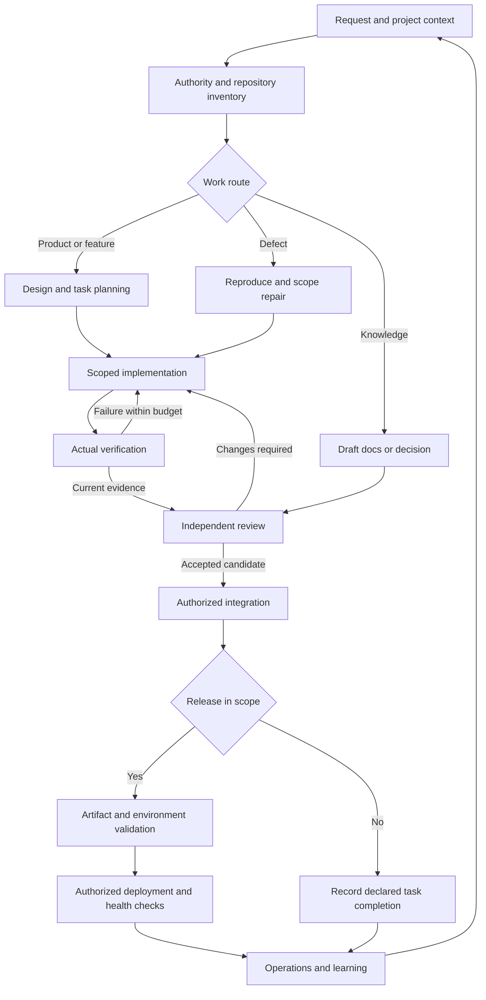

# GIDF-SKILLS-001 — GitHub Project Delivery Skill Framework

Version 1.0.0 • 12 October 2026 • Prepared for Vily / Frames ADF

## Executive decision

Use **one portable entry skill with twelve workflow groups**, shared by Codex, Claude, Gemini and compatible agents. GitHub holds work records and delivery evidence; existing project policy defines action authority. The entry skill routes a request to the smallest relevant workflow and loads its supporting files on demand.

This creates a reusable operating model for business discovery, product and UX design, architecture, planning, development, assurance, integration, release and continuous improvement. It complements an existing GIDF/ADF or project runbook through reconciliation; it does not replace accepted repository authority. The complete earlier GIDF Master Prompt was not supplied in this request, so exact conformance to that document is not certified.

The developed package contains an actual SKILL.md router, twelve workflow modules, shared contracts, a machine-readable registry, provider guidance, templates and two executable tools. It is a framework for delivering projects, rather than an implementation of any particular product.

## Skill groups and workflow outputs

| Group | Scope and GitHub features | Skill workflow | Reviewable output |
|---|---|---|---|
| G01 — Governance | Repository About metadata, settings, rulesets, roles, CODEOWNERS, Environments | Resolve authority → inspect controls → include a purpose-based description when creating a repository → prepare/apply authorized metadata delta | Authority matrix, repository description, and confirmed/proposed configuration |
| G02 — Discovery | Code, Issues, PRs, Projects, Actions, docs | Inventory → pin evidence → reconcile → identify gaps → phase work | Reconciliation matrix and roadmap |
| G03 — Design | Discussions, specs/ADRs, design PRs | Problem/outcome → research → journeys/contracts → acceptance → decision | PRD, functional/UX specification, architecture and acceptance matrix |
| G04 — Planning | Issues/forms/types, sub-issues, dependencies, milestones, Projects, branch topology | Reuse tasks → decompose/link → choose scale-appropriate branches → map fields/views → ready queue | Deduplicated backlog, branch plan, and executable task packets |
| G05 — Agents | Assignments, PR branches, task queues and evidence | Route runtime → scope writers → coordinate → review → hand off | Provider-neutral execution/handoff packet |
| G06 — Development | Code, branches, commits, PRs, Codespaces | Baseline → reproduce/specify → build slice → verify → record | Scoped candidate and behavior proof |
| G07 — Verification | Actions, check runs, jobs, artifacts | Derive checks → reserve counted attempt → execute → classify → revalidate | Current-candidate evidence and preserved attempt ledger |
| G08 — Security | Code scanning, secrets, dependencies, advisories | Map risk → inspect coverage → triage → remediate → verify | Finding/control register and risk disposition |
| G09 — Integration | PR reviews/comments, checks, ownership, merge queue | Inspect exact candidate → disposition findings → obtain policy-required role approvals → refresh gates → integrate under authority | Review dispositions and actual integration outcome |
| G10 — Release | Releases/tags, Packages, Pages, deployments | Pin artifact → prepare recovery → validate staging → publish/deploy → check health | Release/runtime evidence and recovery record |
| G11 — Knowledge | Docs, Discussions, Wiki, Pages | Establish canonical source → document decisions → synchronize → learn | Current docs, decisions and onboarding |
| G12 — Operations | Insights, charts, incidents, telemetry | Define indicators → measure → mitigate/repair → feed backlog | Performance report, incident record and improvement tasks |

Each workflow includes triggers, inputs, ordered actions, outputs, exit criteria and recovery behavior. The groups are callable modules behind one native skill, not twelve independent installed skills. Split a module into its own skill only when actual usage demonstrates a distinct discovery need.

## Project workflow



The route changes with the task. A design-only task ends with accepted design evidence; a deploy task requires actual runtime validation. A documentation correction need not traverse a complete product discovery cycle. Security and governance work apply where their triggers are present.

Common routes are:

- Adoption/UPGRADE: G01 → G02 → G04 → G05, followed by the authorized configuration/implementation subset.
- Product/feature: G03 → G04 → G05 → G06 → G07 → G09, with G01/G02 for current context, G08 for relevant risk and G10 for release scope.
- Defect: G02 → G06 → G07 → G09; use G08 for a security defect.
- Release/operations: G10 → G12, feeding measured improvements into G03/G04.
- Provider switch/resumption: G05, then the remaining task workflow without resetting history or budgets.

## How GitHub features work together

The **Issue** is the durable work contract: outcome, scope, owner, acceptance, dependencies and evidence. **Sub-issues** express decomposition; **dependencies** express blocking relationships. **Projects** provide views, capacity and prioritization around those records. **PRs** carry proposed code/document changes and integration evidence. **Actions** supply actual check/build/deployment results. These resources need explicit links, current revisions and agreed completion boundaries.

**Discussions** support proposals and stakeholder feedback. Accepted decisions move into the canonical Issue, ADR or policy document. **Wiki** provides navigable knowledge when enabled; versioned contracts/policy should retain one canonical source. **Pages** is a publication target that needs an authorized delivery workflow. **Releases/Packages** represent distributed artifacts; **Environments/deployments** represent runtime actions. **Security and quality** findings feed scoped remediation. **Insights** contributes repository trends, supplemented by deployment, customer and operational telemetry.

Feature availability, account permission and connector support are separate facts. For example, an integration can read PRs while lacking Project field access or administrative APIs. That gap should produce a reviewable fallback and an explicit unknown, not invented configuration IDs or a claim that no protections exist.

## Shared agent operating model

| Concern | Codex | Claude Code | Gemini CLI | Other agents |
|---|---|---|---|---|
| Shared content | Same skill version and contracts | Same | Same | Same where supported |
| Project skill discovery | `.agents/skills/` | `.claude/skills/` | `.agents/skills/` or `.gemini/skills/` | Host's documented directory |
| Project instructions | Applicable AGENTS.md | Applicable CLAUDE.md plus shared-policy pointer | Applicable GEMINI.md plus shared-policy pointer | Host-specific context |
| Invocation | `$github-project-delivery` | `/github-project-delivery` | Request the skill; verify discovery | Native invocation or explicit file loading |
| Proof required | Discover and execute a read-only fixture | Same | Same | Same |

Native skill paths are grounded in current official documentation. Shared file format does not mean identical tool behavior or proven compatibility. Cloud sessions may have different discovery/configuration rules from local CLI sessions.

Choose conceptual roles by task: coordinator, product/UX, architect, developer, reviewer, auditor when project policy requires it, QA, security and release/operations. Reviewer assesses the change; auditor checks scope, controls and evidence. Require separate identities for dual sign-off when specified. Choose model/runtime using supported capabilities, complexity, quality and cost. Keep the role contract independent of the model brand. Parallel execution uses one writer per scope and a coordinator when delegation is authorized; sequential execution follows the same contracts.

The local installer previews its destination by default, stages and verifies a skill before copying it only with `--apply`, and preserves conflicting destinations. If a publish fails partway, it leaves the destination for inspection instead of deleting files that may have appeared concurrently. It does not rewrite AGENTS.md/CLAUDE.md/GEMINI.md, configure connectors or change permissions.

Example after obtaining the source checkout:

```bash
cd skills/github-project-delivery
python3 scripts/install_skill.py --destination /path/to/project/.agents/skills
python3 scripts/install_skill.py --destination /path/to/project/.claude/skills
```

Review destinations, apply the required copies, reconcile instruction pointers and commit adopted files through the target project's workflow. Pin copies to one source commit/hash and verify drift on updates.

## Delivery controls and evidence

Record five independent fields:

| Field | Purpose |
|---|---|
| task_state | Planning/execution/blocked/completion boundary |
| verification_state | Actual check status |
| integration_state | PR and merge outcome |
| runtime_state | Environment/deployment outcome |
| business_acceptance | Accountable acceptance of the intended outcome |

A Done board item, closed Issue or passing local test cannot stand in for these other observations. An approved review or successful CI run covering an old revision proves only that old revision's result. Reconcile current head/base, required checks, reviewer eligibility, live rules and target artifact before integration or release decisions. Track material comments through a verified disposition. When policy or the user requires auditor and reviewer approval, require distinct identities and approvals on the same current head; a reply or snapshot alone does not establish acceptance.

Use a global composed-attempt ledger if the project requires a cap. Define the counting unit once. Preserve successful, failed, reserved and interrupted attempts across agents/providers. One coordinator serializes reservation and execution. A comment or JSON snapshot is not a distributed lock. The included evidence checker counts supplied entries and detects stale/incomplete evidence; it does not enforce atomic reservations or live GitHub authority.

Every record should identify the exact revisions, actual commands/results, environment/time, acceptance IDs, run/job/artifact links, limits and next action. Handoffs use one concise canonical record with links to detail. Earlier stopped work remains historical evidence.

## Templates and executable development

The skill package includes four templates: task, evidence, handoff and release. The wider framework describes other possible project artifacts, but they are not part of this portable skill archive and must be reconciled with the target repository before adoption.

It also includes:

- `check_evidence.py`: validates a supplied snapshot, can check optional auditor/reviewer role labels on the exact candidate head, and reports remaining attempts. Its result is advisory and never enforces policy; live permissions, CODEOWNERS, identities, comment state, provenance and runtime health remain outside its scope.
- `install_skill.py`: previews/copies the complete local skill, accepts identical reruns, rejects conflicts and recursive destinations, and preserves final destinations after a race or partial publish.
- `registry.json`: twelve group identifiers, source files, standard routes, version and conditional routing rules.
- `agents/openai.yaml`: optional Codex interface metadata; common SKILL.md frontmatter stays portable.

## Selected plugin and skill use

The build used GitHub's official documentation repository, Context7, Parallel Search and Firecrawl for capability/documentation grounding; Consensus for research discovery and a fetched repository-level evaluation paper; Superpowers for skill writing/testing; Matt Pocock's agent-writing guidance; Agent Skills for lifecycle routing; Agent Reach for native-source adaptation; and defensive OSINT guidance for evidence handling.

Other selected integrations have conditional roles. Malwarebytes serves reputation questions; Mobbin supplies UX references; Magnific supplies creative assets; AI Workflow Architect previews a sufficiently described business workflow. They were mapped into the framework without running unrelated reputation queries, design asset generation or an incomplete workflow intake. Consensus provides scientific research, rather than multi-agent decision voting.

## Adoption roadmap

| Phase | Work | Completion evidence |
|---|---|---|
| P0 — Reconcile | Audit policy, tasks, Projects and capabilities; map existing GIDF/ADF/runbook requirements | Inventory, authority matrix, no duplicate backlog, known limitations |
| P1 — Pilot | Install in a permitted sandbox/project checkout; reconcile host pointers; deliver one feature/defect/docs task | Native skill discovery, current-candidate checks, usable handoff |
| P2 — Expand | Adopt needed templates and authorized Project/Actions automation | Validated fields/options, stable check routing, independent review |
| P3 — Release and operate | Integrate artifact/environment controls and operational feedback | Actual deployment/health evidence and measured delivery indicators |

For a small project, use the router, Issues, PRs, relevant checks and concise evidence. Add portfolio Project fields, specialized reviewers, transactional orchestration and richer operational instrumentation when project complexity justifies them. The same twelve groups cover the lifecycle at either scale.

Examples for the user's projects: BizTrust can connect accepted insurance journeys, contracts and tenant-isolation requirements to G03/G07/G08; bERP can reconcile module and environment work with existing Handbook/ADRs before G04/G10 changes; BADF/ADF can supply established admission/authority/evidence controls to G01/G05. These are application recommendations, not claims of current repository inspection.

## Performance indicators

Measure defined delivery boundaries rather than activity alone. Suggested indicators are median ready-to-accepted cycle time; blocked age; review turnaround; percentage of tasks with current verification evidence; dependency-related rework; deployed change failure rate; incident recovery time; and the agreed product/business outcome. Record window, timezone, denominator, exclusions and data coverage. Projects/Insights alone cannot establish all runtime or revenue indicators.

## Reusable launch prompt

```text
Use github-project-delivery (GIDF-SKILLS-001 v1.0.0).
Project: <name>
Repository: <explicit owner/repository URL>
Mode: <AUDIT / NEW / UPGRADE / authorized EXECUTE>
Task: <existing Issue or requested discovery outcome>
Business outcome: <observable value>
Completion boundary: <design / verified PR / integrated release / named runtime>
Authority: <current governing instructions and recorded authorization>
Constraints: <relevant business, technical, cost, time and data limits>

Begin with authority and a read-only inventory. Reconcile existing work before
additions. Select the smallest workflow route and execute authorized actions.
Preserve actual evidence, stopped history and the global attempt ledger.
Prepare the next reviewable result before seeking a missing decision. Report
verification, integration, runtime and business acceptance separately.
```

## Validation and remaining proof

The v1.3.0 candidate passes **24 automated Python tests**, including CLI exit handling, malformed snapshots, stale head/base evidence, stale/dismissed reviews, duplicate and missing role approvals, missing checks, incomplete acceptance, blocked dependencies, attempt reservations/interruptions/caps, dry-run behavior, installer publish races, registry paths, package-local Markdown links, and repository-setup route coverage. These are package checks, not a skill release gate. One independent read-only synthetic fixture run exercised v1.2.0 scaled branch planning and review acceptance; the new repository-description behavior cases and other authored behavior cases remain pending. Native host discovery, live policy enforcement, and target-repository adoption are unverified.

Fresh-agent applications covered a deadline-pressured release handoff and a mixed repository adoption inventory. The initial handoff was accurate but unnecessarily long; its output contract was revised and retested. A no-skill control already respected major safety and authority boundaries, so these applications do not establish a measured performance improvement over baseline.

Native Codex, Claude Code and Gemini CLI executables are unavailable in this environment. Their discovery/invocation tests, live Project configuration, hosted Actions and target-repository adoption remain unperformed. The framework has been developed and locally validated; no target repository settings, Issues, PRs, releases or deployments were changed during this generic build.

## Primary sources

- [Agent Skills specification](https://agentskills.io/specification)
- [OpenAI skill documentation](https://developers.openai.com/codex/build-skills/)
- [Claude Code skills](https://code.claude.com/docs/en/skills)
- [Gemini CLI skills](https://geminicli.com/docs/cli/skills/)
- [GitHub Projects](https://docs.github.com/en/issues/planning-and-tracking-with-projects/learning-about-projects/about-projects)
- [GitHub native issue dependencies](https://docs.github.com/en/issues/tracking-your-work-with-issues/using-issues/creating-issue-dependencies)
- [GitHub rulesets](https://docs.github.com/en/repositories/configuring-branches-and-merges-in-your-repository/managing-rulesets/about-rulesets)
- [Deployment environments](https://docs.github.com/en/actions/how-tos/deploy/configure-and-manage-deployments/manage-environments)
- [Actions secure use](https://docs.github.com/en/actions/reference/security/secure-use)
- [SWE-PolyBench research paper](https://arxiv.org/abs/2504.08703)

Feature/format facts come from primary documentation; group boundaries, templates, controls and roadmap are framework design recommendations. Candidate contents, evaluation limits and checksum are recorded in `dist/CANDIDATE-v1.3.0.md`.

## Source version and recovery

The current source workspace has no Git history. The portable v1.3.0 candidate archive and SHA-256 are recorded in `dist/CANDIDATE-v1.3.0.md`; prior v1.1.0, v1.1.1, and v1.2.0 candidate artifacts are retained in `dist/`. The release gate remains incomplete, and no hosted release or target-repository adoption is claimed. The installed runtime copy remains a separate artifact and must be updated through its authorized installation workflow.
